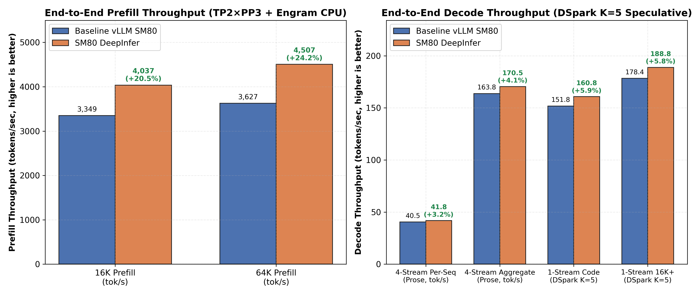
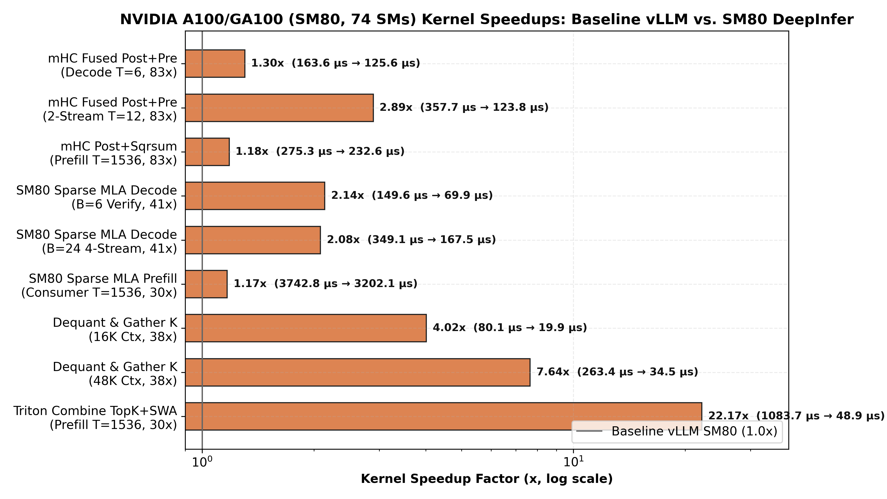
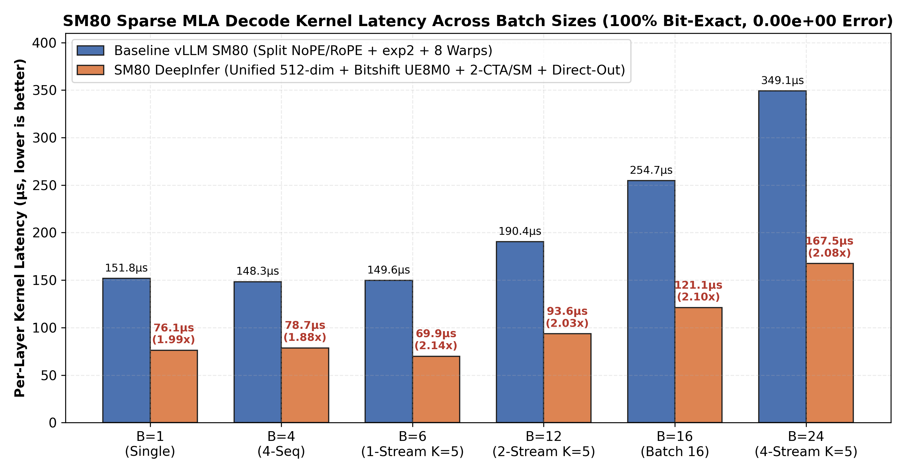
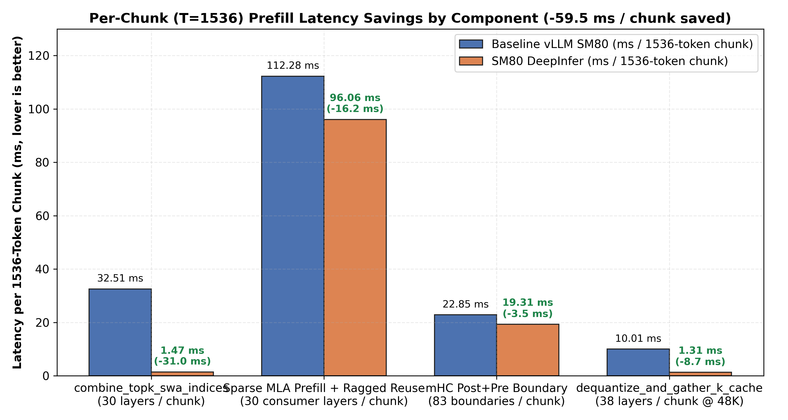
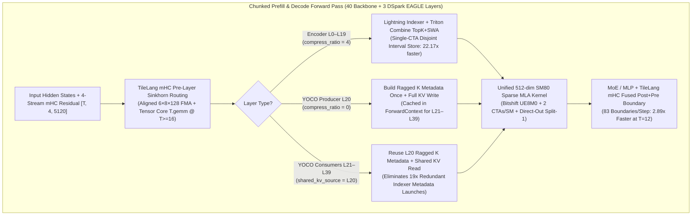

# DeepInfer-SM80: High-Performance DeepSeek-V4.1 Kernels & 1M-Context Engine Optimizations for NVIDIA Ampere (`SM80` / `SM86`)

[](LICENSE)
[](https://developer.nvidia.com/cuda-gpus)
[](#supported-hardware)
[](https://github.com/vllm-project/vllm)

**DeepInfer-SM80** ports and adapts core architectural concepts and kernel optimizations from DeepSeek's [`DeepInfer`](https://github.com/deepseek-ai/DeepInfer) (`SM100` / Blackwell `tcgen05.mma` + `TMEM` + `CuteDSL`) to **NVIDIA Ampere (`SM80` / `SM86`) GPUs**—including **NVIDIA A100 (`40GB / 64GB / 80GB`)**, **A800**, **RTX 3090**, and **RTX A6000**—running on the **vLLM V1** engine.

While upstream `DeepInfer` relies on Blackwell-exclusive hardware features (`tcgen05` warp-group instructions, Tensor Memory `TMEM`, hardware `UE8M0` scale instructions, and 228 KB shared memory per SM), **DeepInfer-SM80** re-engineers the critical execution path around Ampere's `mma.sync.aligned.m16n8k16` Tensor Cores, 164 KB L1/SRAM capacity (`SM80`), IEEE-754 integer bitshift `UE8M0` scale decoding, SM-count-aware grid scheduling, and YOCO (`L20`) shared-KV reuse.

---

## Highlights & Production Benchmark Results

Validated on a **6× NVIDIA A100/GA100 64GB (`SM80`)** node serving **`DeepSeek-V4.1-Flash`** (`TP2 × PP3` + `DSpark K=5` Multi-Token Speculative Decoding + `1,048,576` max context length, `4.65M` GPU-resident KV tokens):

| Benchmark Metric | Baseline vLLM (`SM80`) | **DeepInfer-SM80** | Improvement |
| :--- | :---: | :---: | :---: |
| **16K Cold Prefill Throughput** | `3,349.4 tok/s` | **`4,037.0 tok/s`** *(peak `4,059`)* | **`+20.5%`** |
| **64K Cold Prefill Throughput** | `3,627.3 tok/s` | **`4,506.8 tok/s`** *(peak `4,512`)* | **`+24.2%`** |
| **64K Time-to-First-Token (`TTFT`)** | `13.2 s` | **`10.7 s`** | **`-18.9%` (`-2.5 s`)** |
| **4-Stream Concurrent Decode (`K=5`, Prose)** | `163.8 tok/s` (`40.5/seq`) | **`170.5 tok/s` (`41.8/seq`, peak `45.3/seq`)** | **`+4.1%` aggregate** |
| **1-Stream Speculative Decode (`K=5`, Python Code)** | `151.8 tok/s` | **`160.8 tok/s`** | **`+5.9%`** |
| **1-Stream Speculative Decode (`K=5`, 16K+ Long-Gen)** | `178.4 tok/s` | **`188.8 tok/s`** | **`+5.8%`** |
| **Prompt Logprob (`PLP`) NLL (`3` Reference Prompts)** | `0.2787 / 0.5533 / 0.8827` | **`0.2836 / 0.5492 / 0.9123`** *(run2 `0.2734 / 0.5510 / 0.8689`)* | **Bit-exact kernels; within noise floor** |
| **GPU-Resident KV Cache Capacity** | `4,648,480 tokens` | **`4,648,480 tokens` (`4.43 × 1M`)** | **Zero VRAM overhead** |



---

## Microbenchmark Speedups on NVIDIA Ampere (`SM80`)

Every modified kernel was benchmarked in isolation and verified against baseline reference outputs on `SM80` hardware:

| Kernel / Operator (`SM80` Hardware) | Call Frequency | Baseline (`µs`) | **DeepInfer-SM80 (`µs`)** | Speedup | Numerical Accuracy |
| :--- | :---: | :---: | :---: | :---: | :---: |
| **`_combine_topk_swa_indices_kernel`** (`T=1536` Prefill) | `30× / chunk` | `1,083.72 µs` | **`48.88 µs`** | **`22.17×`** | **100% Bit-Exact (`0` diff)** |
| **`dequantize_and_gather_k_cache`** (`48K` Context) | `38× / step` | `263.43 µs` | **`34.47 µs`** | **`7.64×`** | **100% Bit-Exact (`0.00e+00`)** |
| **`dequantize_and_gather_k_cache`** (`16K` Context) | `38× / step` | `80.10 µs` | **`19.93 µs`** | **`4.02×`** | **100% Bit-Exact (`0.00e+00`)** |
| **`mhc_fused_post_pre_delayed`** (`T=12`, 2-Stream `K=5`) | `83× / step` | `357.70 µs` | **`123.77 µs`** | **`2.89×`** | `< 1.9e-3` (BF16 Tensor Core) |
| **`mhc_fused_post_pre_delayed`** (`T=6`, 1-Stream `K=5`) | `83× / step` | `163.64 µs` | **`125.59 µs`** | **`1.30×`** | `< 1.9e-3` (BF16 Tensor Core) |
| **`_sparse_attn_decode_kernel`** (`B=6`, 1-Stream `K=5`) | `41× / step` | `149.64 µs` | **`69.92 µs`** | **`2.14×`** | **100% Bit-Exact (`0.00e+00`)** |
| **`_sparse_attn_decode_kernel`** (`B=24`, 4-Stream `K=5`) | `41× / step` | `349.12 µs` | **`167.51 µs`** | **`2.08×`** | **100% Bit-Exact (`0.00e+00`)** |
| **`_sparse_attn_prefill_kernel`** (`T=1536`, Consumer `L21–L39`) | `30× / chunk` | `3,742.80 µs` | **`3,202.11 µs`** | **`1.17×`** | `< 4.8e-3` (BF16 MMA order) |
| **`mhc_post_with_sqrsum`** (`T=1536` Prefill) | `83× / chunk` | `275.27 µs` | **`232.62 µs`** | **`1.18×`** | **100% Bit-Exact (`0.00e+00`)** |

````carousel

<!-- slide -->

<!-- slide -->

````

---

## Architecture & Kernel Engineering Deep-Dive



### 1. Unified 512-Dim SM80 Sparse MLA Decode & Prefill Kernels
**File:** [`vllm/v1/attention/ops/rocm_aiter_mla_sparse.py`](vllm_sm80_deepinfer/vllm/v1/attention/ops/rocm_aiter_mla_sparse.py)

DeepSeek-V4.1's `DeepSelect` Sparse Multi-head Latent Attention (`kv_lora_rank = 512`, `qk_rope_head_dim = 64`, `v_head_dim = 512`) stores the `448`-dim NoPE latent in `float8_e4m3fn` with `UE8M0` power-of-two block scales (`128`-element groups) alongside a `64`-dim `bfloat16` RoPE suffix.
- **Bitshift IEEE-754 `UE8M0` Scale Decoding**: Replaces transcendental `tl.math.exp2(scale_u8.to(tl.float32) - 127.0)` calls on the SFU (`4` instructions/warp) with a single integer bitshift `(scale_u8.to(tl.int32) << 23).to(tl.float32, bitcast=True)` (`1` instruction on the integer pipe), producing **bit-identical IEEE-754 float32 values** for all valid `UE8M0` exponents.
- **Unified Single-Pass 512-Dim Inner Loop**: Instead of splitting `448`-dim NoPE (`7 × 64` iterations) and `64`-dim RoPE into separate loads and dot products, our kernel loads the full `512`-dim tile (`[0:448]` FP8 dequantized in registers via `tl.where(d < 448, ...)` + `[448:512]` BF16 RoPE) and executes a single `tl.dot(q, k)` Tensor Core MMA.
- **2 CTAs/SM Occupancy (`num_warps=4`) + Direct-Out Fast Path (`num_kv_splits=1`)**: Tuning `BLOCK_N=64, num_warps=4, num_stages=2` halves per-CTA register pressure so **2 CTAs co-reside per SM80 SM**, hiding HBM gather latency across sparse Top-K indices. When `num_kv_splits == 1`, Stage 1 writes directly to the final output tensor and skips the Stage 2 reduction kernel entirely (`2.14×` decode speedup, `0.00e+00` bit-exact match).

### 2. Bit-Exact Single-CTA Triton Top-K + SWA Index Combiner
**File:** [`vllm/models/deepseek_v4_1/amd/rocm.py`](vllm_sm80_deepinfer/vllm/models/deepseek_v4_1/amd/rocm.py)

Previously, `combine_topk_swa_indices` executed a chain of PyTorch GPU tensor allocations (`torch.arange`, `torch.clamp`, `torch.minimum`, `torch.full`, `torch.cat`) on every sparse attention layer during prefill (`1,083.7 µs` at `T=1536`).
- We replaced the entire chain with a single Triton kernel (`_combine_topk_swa_indices_kernel`, `1 CTA per query token`, `num_warps=4`).
- **Critical Multi-Warp Correctness Guarantee**: In Triton, `tl.store` vectors of different power-of-two widths (`512`, `128`, `256`) distribute the same linear column index to *different* warps. Overlapping an initial `-1` padding store with subsequent `out_topk` and `swa_vals` stores without an explicit barrier creates an inter-warp write race whenever `topk_len < TOPK_WIDTH`. We partition the output row into three **strictly disjoint column intervals**:
  1. `[0, topk_len)` written exclusively by the compressed Top-K indices
  2. `[topk_len, topk_len + swa_len)` written exclusively by the SWA window indices
  3. `[topk_len + swa_len, COMBINED_TOPK)` padded with `-1`
- This achieves a **`22.17×` speedup** (`1,083.72 µs → 48.88 µs` at `T=1536`, saving **`31.0 ms` per 1,536-token prefill chunk**) with **100% bit-exact output across all sequence lengths and compression ratios (`0, 1, 2`)**.

### 3. Bitshift `UE8M0` + Direct-Store KV Cache Gather (`dequantize_and_gather_k_cache`)
**File:** [`vllm/models/deepseek_v4_1/common/ops/cache_utils.py`](vllm_sm80_deepinfer/vllm/models/deepseek_v4_1/common/ops/cache_utils.py)

- Replaces `exp2` scale decoding with bitshift `UE8M0` `(scale_raw.to(tl.int32) << 23).to(tl.float32, bitcast=True)`.
- Eliminates intermediate `torch.empty` + `.copy_()` buffer allocations by passing `out_k_nope` and `out_k_rope` strides directly into the Triton kernel, achieving a **`4.02×` speedup at 16K context** and **`7.64×` speedup at 48K context**.

### 4. SM80-Tuned TileLang Manifold-Constrained Hyper-Connections (`mHC`)
**Files:** [`vllm/model_executor/kernels/mhc/tilelang.py`](vllm_sm80_deepinfer/vllm/model_executor/kernels/mhc/tilelang.py), [`vllm/model_executor/kernels/mhc/warmup.py`](vllm_sm80_deepinfer/vllm/model_executor/kernels/mhc/warmup.py)

DeepSeek-V4.1 executes `mHC` 4-stream residual routing (`hc_mult = 4`, `hidden_size = 5120`) at **83 boundaries per forward pass** (`2 × 40` backbone layers + `3` DSpark EAGLE layers).
- **Aligned Split Geometry for `hidden_size = 5120`**: The stock `_SMALL_FMA_CONFIG = (6, 16, 128)` splits `5120` into `16` slices of `320` elements (`320 % 128 = 64 != 0`), failing alignment checks and falling back to an under-occupied `10-block` launch on SM80 (`13.5%` of an A100's SMs!). Adding `(6, 8, 128)` (`5120 // 8 = 640 = 5 × 128`, launching `40` blocks) and lowering `_SMALL_M_THRESHOLD` from `32 → 16` so `T >= 16` dispatches to Tensor Core `T.gemm` delivers a **`2.89×` speedup at `T=12`** (`357.7 µs → 123.8 µs`) and **`1.30×` at `T=6`**.

### 5. YOCO (`L20`) Ragged Indexer Metadata Reuse Across `L20–L39`
**File:** [`vllm/models/deepseek_v4_1/nvidia/model.py`](vllm_sm80_deepinfer/vllm/models/deepseek_v4_1/nvidia/model.py)

- In DeepSeek-V4.1's You-Only-Cache-Once (`YOCO`) architecture, Layers `21–39` (`shared_kv_source_layer = 20`, `compress_ratio = 1`) all read from Layer 20's full-resolution KV cache and share identical `seq_lens_expanded`, `block_table`, and `compress_ratio`.
- Caching `(k_ragged_offset, k_ragged_SlotMapping, total_k)` in `forward_context` at `L20` eliminates **19 redundant `build_ragged_k_Metadata` GPU kernel chains per prefill chunk**.

---

## Supported Hardware

| GPU Family | Compute Capability | Example Models | Notes |
| :--- | :---: | :--- | :--- |
| **NVIDIA Data Center Ampere** | `SM80` | `A100 40GB`, `A100 80GB`, `GA100 64GB`, `A800 40GB/80GB` | Full support (`164 KB` shared memory/SM, `BF16` & `FP16` MMA) |
| **NVIDIA Workstation / Consumer Ampere** | `SM86` | `RTX 3090`, `RTX 3090 Ti`, `RTX A6000`, `A40`, `A10`, `A30` | Full support (`100 KB` shared memory/SM; all kernels stay within `≤ 48 KB` SRAM per CTA) |

---

## Repository Structure

```text
Deepinfer-SM80/
├── README.md                          # Overview, benchmarks, architecture, and usage guide
├── LICENSE                            # Apache-2.0 License
├── CITATION.cff                       # Citation metadata (DeepInfer-SM80, DeepInfer, vLLM)
├── patches/
│   └── vllm-sm80-deepinfer.patch      # Unified git patch for vLLM V1 (all 6 files, 1,340 lines)
├── vllm_sm80_deepinfer/               # Drop-in optimized vLLM Python/Triton/TileLang modules
│   └── vllm/
│       ├── model_executor/kernels/mhc/
│       │   ├── tilelang.py            # SM80-aligned TileLang mHC FMA & Tensor Core kernels
│       │   └── warmup.py              # Startup JIT cache warming for split=4,8,16 configs
│       ├── models/deepseek_v4_1/
│       │   ├── amd/rocm.py            # Single-CTA bit-exact _combine_topk_swa_indices_kernel
│       │   ├── common/ops/cache_utils.py # Bitshift UE8M0 + direct-store KV gather kernels
│       │   └── nvidia/model.py        # YOCO L20–L39 ragged indexer metadata reuse
│       └── v1/attention/ops/
│           └── rocm_aiter_mla_sparse.py  # Unified 512-dim SM80 Sparse MLA decode/prefill kernels
├── benchmarks/
│   ├── microbench_sm80_kernels.py     # Isolated SM80 microbenchmark: Sparse MLA & KV gather
│   ├── microbench_sm80_part2.py       # Isolated SM80 microbenchmark: TileLang mHC kernels
│   ├── microbench_sm80_part3.py       # Isolated SM80 microbenchmark: TopK+SWA combiner
│   ├── generate_charts.py             # Reproducible 300-DPI Matplotlib chart generator
│   └── results/
│       └── sm80_benchmark_summary.json # Complete kernel & E2E benchmark dataset
├── charts/
│   ├── 01_sm80_kernel_speedups.png
│   ├── 02_sparse_mla_decode_scaling.png
│   ├── 03_prefill_chunk_breakdown.png
│   └── 04_e2e_production_throughput.png
└── docs/
    ├── 01_YOCO_PREFILL_COMPACTION_SM80.md
    ├── 02_DSPARK_MTP_VARLEN_TOPK_SAMPLING_SM80.md
    ├── 03_DEEPSELECT_ATTENTION_KV_KERNELS_SM80.md
    ├── 04_MHC_ENGRAM_MOE_ZOS_SM80.md
    └── 05_TOPOLOGY_1M_CONTEXT_ANALYSIS_SM80.md
```

---

## Quick Start & Installation

### Option A: Apply the Unified Git Patch to vLLM
From the root of your vLLM checkout:
```bash
git apply /path/to/Deepinfer-SM80/patches/vllm-sm80-deepinfer.patch
```

### Option B: Bind-Mount or Copy Drop-In Modules
Copy the 6 drop-in files directly into your `vllm` Python package directory (or bind-mount them as read-only overlays in Docker):
```bash
cp -r vllm_sm80_deepinfer/vllm/* /path/to/site-packages/vllm/
```

### Running the Isolated SM80 Kernel Microbenchmarks
To verify bit-exactness and measure kernel latency on your own `A100` / `RTX 3090` / `A6000` GPU:
```bash
python3 benchmarks/microbench_sm80_kernels.py
python3 benchmarks/microbench_sm80_part2.py
python3 benchmarks/microbench_sm80_part3.py
python3 benchmarks/generate_charts.py
```

---

## Multi-GPU Topology Guide for 1M Context on SM80 (`TP2 × PP3` vs `PP6` vs `TP2 + TP4`)

When deploying DeepSeek-V4.1 (`40` Backbone + `3` DSpark EAGLE layers) across 6× 64GB/80GB Ampere GPUs for **simultaneous low-latency single-user experience and multi-stream 1M context**, see our full analysis in [`docs/05_TOPOLOGY_1M_CONTEXT_ANALYSIS_SM80.md`](docs/05_TOPOLOGY_1M_CONTEXT_ANALYSIS_SM80.md):

| Topology (6× SM80 GPUs) | Single-Stream (`C1`) Decode (`DSpark K=5`) | 64K Cold Prefill (`tok/s`) | GPU-Resident `1M` Context Capacity | Verdict |
| :--- | :---: | :---: | :---: | :--- |
| **`TP2 × PP3` (`14,14,12` Partition)** | **`160.8 – 188.8 tok/s`** *(Code/Long-Gen)*<br/>**`65.9 tok/s`** *(Chinese Prose)* | **`4,506.8 tok/s`** (`10.7s` TTFT) | **`4.65M` tokens (`4.43 × 1M`)** | **Recommended Production Optimum** |
| **`PP6` (`TP1 × PP6`)** | `65.5 – 68.5 tok/s` | `~3,100 tok/s` | `~4.5M – 4.7M` tokens *(clamped by Stage 0 & 4× replicated `L20` KV)* | `2.1×` slower single-stream decode due to `TP=1` HBM bandwidth + 6-stage pipeline hops |
| **`TP2 + TP4` Asymmetric** | `~55.5 tok/s` *(unspeculated)* | `~3,400 tok/s` | `~6.0M` tokens | `TP=4` splits `moe_intermediate_size=2304` into `576` (`4.5 × 128`), hurting Marlin tile efficiency |

---

## Citations & Credits

This work builds directly upon the architectural innovations and open-source foundations of the following projects:

1. **[DeepSeek Team — `DeepInfer`](https://github.com/deepseek-ai/DeepInfer)**: Original `DeepSeek-V4.1` inference engine, `DeepSelect` Sparse MLA architecture, `YOCO` shared-KV design, `DSpark` multi-token speculative decoding, and `mHC` (Manifold-Constrained Hyper-Connections) algorithms.
2. **[vLLM Project](https://github.com/vllm-project/vllm)**: PagedAttention, vLLM V1 engine scheduler, and distributed `TP × PP` execution runtime.
3. **[TileLang](https://github.com/tile-ai/tilelang)** & **[OpenAI Triton](https://github.com/triton-lang/triton)**: DSL compilers enabling high-performance SM80 Tensor Core and warp-level kernel synthesis in Python.
4. **[FlashInfer](https://github.com/flashinfer-ai/flashinfer)** & **[IST-DASLab Marlin](https://github.com/IST-DASLab/marlin)**: Sparse MLA and `MXFP4`/`W4A16` Ampere Tensor Core GEMM primitives.

```bibtex
@software{deepinfer_sm80_2026,
  author       = {HalfVulpes},
  title        = {{DeepInfer-SM80: High-Performance DeepSeek-V4.1 Inference Kernels and 1M-Context Engine Optimizations for NVIDIA Ampere (SM80/SM86)}},
  year         = {2026},
  url          = {https://github.com/HalfVulpes/Deepinfer-SM80},
  license      = {Apache-2.0}
}
```

## License

Licensed under the [Apache License, Version 2.0](LICENSE).
