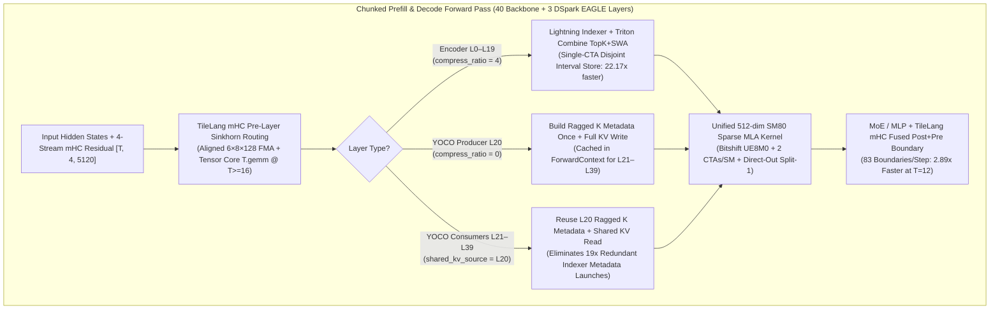

# Architecture & Kernel Engineering

How DeepInfer-SM80 maps DeepInfer's Blackwell (`SM100`) execution path onto Ampere (`SM80` / `SM86`), kernel by kernel. Measured speedups are collected in [BENCHMARKS.md](BENCHMARKS.md); the long-form design notes are the numbered "pillar" documents in this directory.

While upstream `DeepInfer` relies on Blackwell-exclusive hardware features (`tcgen05` warp-group instructions, Tensor Memory `TMEM`, hardware `UE8M0` scale instructions, and 228 KB shared memory per SM), DeepInfer-SM80 re-engineers the critical execution path around Ampere's `mma.sync.aligned.m16n8k16` Tensor Cores, 164 KB L1/SRAM capacity (`SM80`), IEEE-754 integer bitshift `UE8M0` scale decoding, SM-count-aware grid scheduling, and YOCO (`L20`) shared-KV reuse.

## Forward pass overview



## Kernels & engine changes

### 1. Unified 512-Dim SM80 Sparse MLA Decode & Prefill Kernels
**File:** [`vllm/v1/attention/ops/rocm_aiter_mla_sparse.py`](../vllm_sm80_deepinfer/vllm/v1/attention/ops/rocm_aiter_mla_sparse.py)

DeepSeek-V4.1's `DeepSelect` Sparse Multi-head Latent Attention (`kv_lora_rank = 512`, `qk_rope_head_dim = 64`, `v_head_dim = 512`) stores the `448`-dim NoPE latent in `float8_e4m3fn` with `UE8M0` power-of-two block scales (`128`-element groups) alongside a `64`-dim `bfloat16` RoPE suffix.
- **Bitshift IEEE-754 `UE8M0` Scale Decoding**: Replaces transcendental `tl.math.exp2(scale_u8.to(tl.float32) - 127.0)` calls on the SFU (`4` instructions/warp) with a single integer bitshift `(scale_u8.to(tl.int32) << 23).to(tl.float32, bitcast=True)` (`1` instruction on the integer pipe), producing **bit-identical IEEE-754 float32 values** for all valid `UE8M0` exponents.
- **Unified Single-Pass 512-Dim Inner Loop**: Instead of splitting `448`-dim NoPE (`7 × 64` iterations) and `64`-dim RoPE into separate loads and dot products, our kernel loads the full `512`-dim tile (`[0:448]` FP8 dequantized in registers via `tl.where(d < 448, ...)` + `[448:512]` BF16 RoPE) and executes a single `tl.dot(q, k)` Tensor Core MMA.
- **2 CTAs/SM Occupancy (`num_warps=4`) + Direct-Out Fast Path (`num_kv_splits=1`)**: Tuning `BLOCK_N=64, num_warps=4, num_stages=2` halves per-CTA register pressure so **2 CTAs co-reside per SM80 SM**, hiding HBM gather latency across sparse Top-K indices. When `num_kv_splits == 1`, Stage 1 writes directly to the final output tensor and skips the Stage 2 reduction kernel entirely (`2.14×` decode speedup, `0.00e+00` bit-exact match).

### 2. Bit-Exact Single-CTA Triton Top-K + SWA Index Combiner
**File:** [`vllm/models/deepseek_v4_1/amd/rocm.py`](../vllm_sm80_deepinfer/vllm/models/deepseek_v4_1/amd/rocm.py)

Previously, `combine_topk_swa_indices` executed a chain of PyTorch GPU tensor allocations (`torch.arange`, `torch.clamp`, `torch.minimum`, `torch.full`, `torch.cat`) on every sparse attention layer during prefill (`1,083.7 µs` at `T=1536`).
- We replaced the entire chain with a single Triton kernel (`_combine_topk_swa_indices_kernel`, `1 CTA per query token`, `num_warps=4`).
- **Critical Multi-Warp Correctness Guarantee**: In Triton, `tl.store` vectors of different power-of-two widths (`512`, `128`, `256`) distribute the same linear column index to *different* warps. Overlapping an initial `-1` padding store with subsequent `out_topk` and `swa_vals` stores without an explicit barrier creates an inter-warp write race whenever `topk_len < TOPK_WIDTH`. We partition the output row into three **strictly disjoint column intervals**:
  1. `[0, topk_len)` written exclusively by the compressed Top-K indices
  2. `[topk_len, topk_len + swa_len)` written exclusively by the SWA window indices
  3. `[topk_len + swa_len, COMBINED_TOPK)` padded with `-1`
- This achieves a **`22.17×` speedup** (`1,083.72 µs → 48.88 µs` at `T=1536`, saving **`31.0 ms` per 1,536-token prefill chunk**) with **100% bit-exact output across all sequence lengths and compression ratios (`0, 1, 2`)**.

### 3. Bitshift `UE8M0` + Direct-Store KV Cache Gather (`dequantize_and_gather_k_cache`)
**File:** [`vllm/models/deepseek_v4_1/common/ops/cache_utils.py`](../vllm_sm80_deepinfer/vllm/models/deepseek_v4_1/common/ops/cache_utils.py)

- Replaces `exp2` scale decoding with bitshift `UE8M0` `(scale_raw.to(tl.int32) << 23).to(tl.float32, bitcast=True)`.
- Eliminates intermediate `torch.empty` + `.copy_()` buffer allocations by passing `out_k_nope` and `out_k_rope` strides directly into the Triton kernel, achieving a **`4.02×` speedup at 16K context** and **`7.64×` speedup at 48K context**.

### 4. SM80-Tuned TileLang Manifold-Constrained Hyper-Connections (`mHC`)
**Files:** [`vllm/model_executor/kernels/mhc/tilelang.py`](../vllm_sm80_deepinfer/vllm/model_executor/kernels/mhc/tilelang.py), [`vllm/model_executor/kernels/mhc/warmup.py`](../vllm_sm80_deepinfer/vllm/model_executor/kernels/mhc/warmup.py)

DeepSeek-V4.1 executes `mHC` 4-stream residual routing (`hc_mult = 4`, `hidden_size = 5120`) at **83 boundaries per forward pass** (`2 × 40` backbone layers + `3` DSpark EAGLE layers).
- **Aligned Split Geometry for `hidden_size = 5120`**: The stock `_SMALL_FMA_CONFIG = (6, 16, 128)` splits `5120` into `16` slices of `320` elements (`320 % 128 = 64 != 0`), failing alignment checks and falling back to an under-occupied `10-block` launch on SM80 (`13.5%` of an A100's SMs!). Adding `(6, 8, 128)` (`5120 // 8 = 640 = 5 × 128`, launching `40` blocks) and lowering `_SMALL_M_THRESHOLD` from `32 → 16` so `T >= 16` dispatches to Tensor Core `T.gemm` delivers a **`2.89×` speedup at `T=12`** (`357.7 µs → 123.8 µs`) and **`1.30×` at `T=6`**.

### 5. YOCO (`L20`) Ragged Indexer Metadata Reuse Across `L20–L39`
**File:** [`vllm/models/deepseek_v4_1/nvidia/model.py`](../vllm_sm80_deepinfer/vllm/models/deepseek_v4_1/nvidia/model.py)

- In DeepSeek-V4.1's You-Only-Cache-Once (`YOCO`) architecture, Layers `21–39` (`shared_kv_source_layer = 20`, `compress_ratio = 1`) all read from Layer 20's full-resolution KV cache and share identical `seq_lens_expanded`, `block_table`, and `compress_ratio`.
- Caching `(k_ragged_offset, k_ragged_SlotMapping, total_k)` in `forward_context` at `L20` eliminates **19 redundant `build_ragged_k_Metadata` GPU kernel chains per prefill chunk**.

### 6. Multi-Stage Pipeline Parallelism (`TP2 × PP3` & `TP4 × PP2`), Cross-PP Shared KV (`pp_share.py`), & 1M Streamed Indexer
**Files:** [`vllm/models/deepseek_v4_1/pp_share.py`](../vllm_sm80_deepinfer/vllm/models/deepseek_v4_1/pp_share.py), [`vllm/v1/attention/ops/mqa_logits_candidates_triton.py`](../vllm_sm80_deepinfer/vllm/v1/attention/ops/mqa_logits_candidates_triton.py), [`vllm/v1/attention/backends/mla/streamed_workspace.py`](../vllm_sm80_deepinfer/vllm/v1/attention/backends/mla/streamed_workspace.py), [`vllm/models/deepseek_v4_1/nvidia/dspark.py`](../vllm_sm80_deepinfer/vllm/models/deepseek_v4_1/nvidia/dspark.py)

- **Arbitrary Pipeline Partitions Across Shared YOCO Groups (`PPSharePlan`)**: Upstream DeepSeek-V4.1 requires an entire KV-sharing group (`L20–L39`) to reside on a single PP stage, which prevents 3-stage `TP2 × PP3` (`14,14,12`) partitions. `PPSharePlan` (`pp_share.py`) registers byte-identical `CompressedKVReplica` and `DeepseekV4IndexerCache` stand-ins on downstream PP ranks and ships only the newly written `584 B` compressed KV rows, `132 B` indexer K rows, candidate blocks, and top-k indices inside `IntermediateTensors`. Under `TP4 × PP2` (`20,20`), `L20–L39` all reside on `PP1`, so `PPSharePlan` automatically reduces cross-stage `L20` KV shipping to zero.
- **Candidate-Only Triton Indexer Scoring (`mqa_logits_candidates_triton.py`)**: On consumer index layers (`L24/28/32/36`), scores only the `candidate_topk_blocks` published by `L20` instead of the full `[rows, max_seq_len]` context before masking (`8×` fewer scored columns at `128K`, `64×` fewer at `1M`).
- **Bounded 1M-Context Indexer Workspace & Exact-Size Pinned Engram Tables**: `streamed_workspace.py` bounds prefill gather buffers to one window (`~135 MB` instead of `40 × 1M × 132 B = 5.28 GB`), while `common/engram.py` + `weight_utils.py` pin exact-size host Engram shards via `cudaHostRegister` and multi-threaded `pread` without `mmap` OOMs.
- **TP-Sharded DSpark on PP (`nvidia/dspark.py`, `spec_decode/dspark/utils.py`, `model_runner.py`)**: Enables `DSpark K=5` speculative decoding on `TP2 × PP3` and `TP4 × PP2` with `VocabParallelEmbedding` shard loading, non-first-rank `input_ids` propagation, and structured-output grammar draft masking.

## Repository layout

```text
Deepinfer-SM80/
├── README.md                          # Overview, headline results, quick start
├── LICENSE                            # Apache-2.0 License
├── CITATION.cff                       # Citation metadata (DeepInfer-SM80, DeepInfer, vLLM)
├── patches/
│   ├── 00-vllm-pr56201-sm80-base.patch # Base SM80 enablement patch on top of vllm PR #56201 (79a7108d9a)
│   └── vllm-sm80-deepinfer.patch      # Complete DeepInfer-SM80 + PP/DSpark/1M-context patch (30 files, 4,289 lines)
├── vllm_sm80_deepinfer/               # Drop-in optimized vLLM Python/Triton/TileLang modules (all 30 files)
│   └── vllm/
│       ├── model_executor/
│       │   ├── kernels/mhc/{tilelang.py, warmup.py}  # SM80-aligned TileLang mHC kernels & warmup
│       │   ├── layers/sparse_attn_indexer.py         # Candidate-only Triton scoring for L24/28/32/36
│       │   ├── model_loader/weight_utils.py          # Non-mmap pread loader for skipped Engram shards
│       │   └── models/qwen3_dspark.py                # DSpark confidence head & top-token helpers
│       ├── models/deepseek_v4_1/
│       │   ├── amd/rocm.py                           # Single-CTA bit-exact _combine_topk_swa_indices_kernel
│       │   ├── ampere/ampere_sparse.py               # SM80 SWA metadata builder (no FlashMLA dependency)
│       │   ├── attention.py                          # Per-head Triton indexer warmup
│       │   ├── common/engram.py                      # Exact-size cudaHostRegister + C pthread pread gather
│       │   ├── common/ops/cache_utils.py             # Bitshift UE8M0 + direct-store KV gather kernels
│       │   ├── nvidia/{model.py, vl_model.py, dspark.py} # YOCO metadata reuse, PP input_ids, TP-sharded DSpark
│       │   └── pp_share.py                           # Cross-PP YOCO shared KV / indexer-K / candidate replication
│       └── v1/
│           ├── attention/backends/{utils.py, mla/indexer.py, mla/streamed_workspace.py}
│           ├── attention/ops/{rocm_aiter_mla_sparse.py, mqa_logits_candidates_triton.py}
│           ├── core/{kv_cache_utils.py, single_type_kv_cache_manager.py, sched/*}
│           ├── structured_output/utils.py
│           └── worker/gpu/{model_runner.py, cudagraph_utils.py, sample/batch_shard.py, spec_decode/*}
├── scripts/
│   ├── apply_patches.sh               # Check base commit, apply both patches, assert key modules exist
│   ├── check_dropin_sync.py           # Byte-compare vllm_sm80_deepinfer/ with a vLLM tree
│   ├── verify_env.py                  # Print capability / SM count / smem / versions, fail on non-Ampere
│   └── run_microbench_single_gpu.sh   # Run the three microbenchmarks on one GPU and archive logs
├── docker/
│   └── Dockerfile.sm80                # CUDA 13.0 + Python 3.12 + GCC 13 Ampere-only build
├── .github/workflows/patch-stack.yml  # GPU-free CI: patch stack applies and matches the drop-ins
├── benchmarks/
│   ├── bench_8gpu_scaling.py          # 8-GPU TP4xPP2 decode & prefill concurrency benchmark
│   ├── microbench_sm80_kernels.py     # Isolated SM80 microbenchmark: Sparse MLA & KV gather
│   ├── microbench_sm80_part2.py       # Isolated SM80 microbenchmark: TileLang mHC kernels
│   ├── microbench_sm80_part3.py       # Isolated SM80 microbenchmark: TopK+SWA combiner
│   ├── generate_charts.py             # Reproducible 300-DPI Matplotlib chart generator
│   └── results/
│       ├── sm80_benchmark_summary.json # Complete kernel & E2E benchmark dataset
│       └── <date>-<gpu>/               # Archived independent runs (env.txt + logs)
├── charts/
│   ├── 01_sm80_kernel_speedups.png
│   ├── 02_sparse_mla_decode_scaling.png
│   ├── 03_prefill_chunk_breakdown.png
│   ├── 04_e2e_production_throughput.png
│   └── 05_8gpu_tp4pp2_scaling_1_2_4_12.png
└── docs/
    ├── REPRODUCTION.md                 # Install / build / verify procedure and pitfalls
    ├── BENCHMARKS.md                   # Full benchmark tables and charts
    ├── ARCHITECTURE.md                 # This document
    ├── 01_YOCO_PREFILL_COMPACTION_SM80.md
    ├── 02_DSPARK_MTP_VARLEN_TOPK_SAMPLING_SM80.md
    ├── 03_DEEPSELECT_ATTENTION_KV_KERNELS_SM80.md
    ├── 04_MHC_ENGRAM_MOE_ZOS_SM80.md
    └── 05_TOPOLOGY_1M_CONTEXT_ANALYSIS_SM80.md
```
