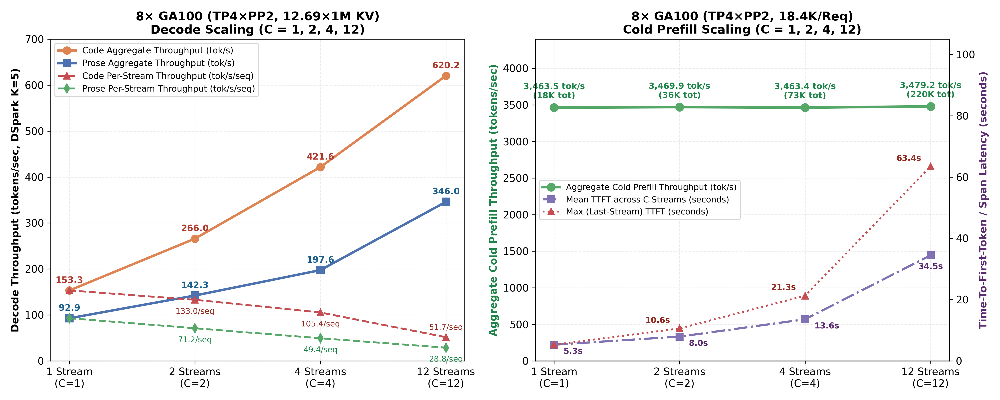

# Benchmarks

All numbers below were measured on NVIDIA GA100 64GB (`SM80`, 74 SMs) nodes serving `DeepSeek-V4.1-Flash`. Raw data: [`benchmarks/results/sm80_benchmark_summary.json`](../benchmarks/results/sm80_benchmark_summary.json); charts are regenerated with [`benchmarks/generate_charts.py`](../benchmarks/generate_charts.py). Independent runs on other hardware are archived under [`benchmarks/results/`](../benchmarks/results/) (e.g. the [A800-SXM4-80GB](../benchmarks/results/20261027-a800-80gb-108sm/SUMMARY.md) and [A100-SXM4-80GB](../benchmarks/results/20261028-a100-sxm4-80gb-108sm/SUMMARY.md) runs, both 108 SMs).

## End-to-end serving

### 1. 8× NVIDIA GA100 64GB (`SM80`) — `TP4 × PP2` (`20, 20`) + `DSpark K=5` (`12.69 × 1M` Context Pool)

Scaling from 6 GPUs (`TP2 × PP3`) to **8× NVIDIA A100/GA100 64GB (`SM80`)** in a balanced 2-stage pipeline (**`TP4 × PP2`**, `VLLM_PP_LAYER_PARTITION=20,20`, `--gpu-memory-utilization 0.95`, `max_num_seqs=12`) places all 20 encoder layers (`L0–L19`) on `PP0` and all 20 YOCO consumer layers (`L20–L39` + `3` DSpark EAGLE draft layers) on `PP1`—completely **eliminating cross-stage KV replication of Layer 20 (`compress_ratio=1`)** and unlocking **`13,306,380` GPU-resident KV tokens (`12.69 × 1M` full context windows, `2.86×` capacity vs 6 GPUs)**:

| Concurrency (`C`) | **Decode: Code (`K=5`, `512` tok/seq)** | **Decode: Prose (`K=5`, `512` tok/seq)** | **Cold Prefill (`18.4K` tok/req)** | **Prefill Mean / Max TTFT** |
| :---: | :---: | :---: | :---: | :---: |
| **`C = 1`** (`1` Stream) | **`153.35 tok/s`** (`153.35/seq`) *(1024-tok run: **`179.74 tok/s`**)* | **`92.89 tok/s`** (`92.89/seq`) | **`3,463.5 tok/s`** (`18.3K` total) | `5.30 s` / `5.30 s` |
| **`C = 2`** (`2` Streams) | **`265.96 tok/s`** (`132.98/seq`, wall `257.4`) | **`142.31 tok/s`** (`71.16/seq`, wall `139.3`) | **`3,469.9 tok/s`** (`36.8K` total) | `7.95 s` / `10.60 s` |
| **`C = 4`** (`4` Streams) | **`421.64 tok/s`** (`105.41/seq`, wall `315.3`) *(1024-tok run: **`401.49 tok/s`**)* | **`197.56 tok/s`** (`49.39/seq`, wall `195.8`) | **`3,463.4 tok/s`** (`73.7K` total) | `13.59 s` / `21.29 s` |
| **`C = 12`** (`12` Streams) | **`620.22 tok/s`** (`51.68/seq`, wall `521.8`) | **`345.99 tok/s`** (`28.83/seq`, wall `311.5`) | **`3,479.2 tok/s`** (`220.7K` total) | `34.48 s` / `63.43 s` |

- **Long-Context Single & Multi-Stream Cold Prefill (`TP4 × PP2`)**:
  - `40.6K` prompt (`C=1`): **`3,541.5 tok/s`** (`11.47 s` TTFT)
  - `162.2K` prompt (`C=1`): **`3,436.1 tok/s`** (`47.20 s` TTFT)
  - `4 × 162.2K` prompts (`C=4`, `649K` total tokens): **`3,471.2 tok/s`** aggregate (`187.05 s` wall span)
  - `649.0K` single-stream prompt (`C=1`): **`2,759.9 tok/s`** (`235.16 s` TTFT, `63.27 GiB / 64.00 GiB` peak VRAM on `PP1`)

### 2. 6× NVIDIA GA100 64GB (`SM80`) — Baseline vLLM vs. DeepInfer-SM80 (`TP2 × PP3`)

Validated on a **6× NVIDIA A100/GA100 64GB (`SM80`)** node serving **`DeepSeek-V4.1-Flash`** (`TP2 × PP3` + `DSpark K=5` Multi-Token Speculative Decoding + `1,048,576` max context length, `4.65M` GPU-resident KV tokens):

| Benchmark Metric | Baseline vLLM (`SM80`) | **DeepInfer-SM80** | Improvement |
| :--- | :---: | :---: | :---: |
| **16K Cold Prefill Throughput** | `3,349.4 tok/s` | **`4,037.0 tok/s`** *(peak `4,059`)* | **`+20.5%`** |
| **64K Cold Prefill Throughput** | `3,627.3 tok/s` | **`4,506.8 tok/s`** *(peak `4,512`)* | **`+24.2%`** |
| **64K Time-to-First-Token (`TTFT`)** | `13.2 s` | **`10.7 s`** | **`-18.9%` (`-2.5 s`)** |
| **4-Stream Concurrent Decode (`K=5`, Prose)** | `163.8 tok/s` (`40.5/seq`) | **`170.5 tok/s` (`41.8/seq`, peak `45.3/seq`)** | **`+4.1%` aggregate** |
| **1-Stream Speculative Decode (`K=5`, Python Code)** | `151.8 tok/s` | **`160.8 tok/s`** | **`+5.9%`** |
| **1-Stream Speculative Decode (`K=5`, 16K+ Long-Gen)** | `178.4 tok/s` | **`188.8 tok/s`** | **`+5.8%`** |
| **Prompt Logprob (`PLP`) NLL (`3` Reference Prompts)** | `0.2787 / 0.5533 / 0.8827` | **`0.2836 / 0.5492 / 0.9123`** *(run2 `0.2734 / 0.5510 / 0.8689`)* | **Bit-exact kernels; within noise floor** |
| **GPU-Resident KV Cache Capacity** | `4,648,480 tokens` | **`4,648,480 tokens` (`4.43 × 1M`)** | **Zero VRAM overhead** |

## Kernel microbenchmarks

Every modified kernel was benchmarked in isolation and verified against baseline reference outputs on `SM80` hardware:

| Kernel / Operator (`SM80` Hardware) | Call Frequency | Baseline (`µs`) | **DeepInfer-SM80 (`µs`)** | Speedup | Numerical Accuracy |
| :--- | :---: | :---: | :---: | :---: | :---: |
| **`_combine_topk_swa_indices_kernel`** (`T=1536` Prefill) | `30× / chunk` | `1,083.72 µs` | **`48.88 µs`** | **`22.17×`** | **100% Bit-Exact (`0` diff)** |
| **`dequantize_and_gather_k_cache`** (`48K` Context) | `38× / step` | `263.43 µs` | **`34.47 µs`** | **`7.64×`** | **100% Bit-Exact (`0.00e+00`)** |
| **`dequantize_and_gather_k_cache`** (`16K` Context) | `38× / step` | `80.10 µs` | **`19.93 µs`** | **`4.02×`** | **100% Bit-Exact (`0.00e+00`)** |
| **`mhc_fused_post_pre_delayed`** (`T=12`, 2-Stream `K=5`) | `83× / step` | `357.70 µs` | **`123.77 µs`** | **`2.89×`** | `< 1.9e-3` (BF16 Tensor Core) |
| **`mhc_fused_post_pre_delayed`** (`T=6`, 1-Stream `K=5`) | `83× / step` | `163.64 µs` | **`125.59 µs`** | **`1.30×`** | `< 1.9e-3` (BF16 Tensor Core) |
| **`_sparse_attn_decode_kernel`** (`B=6`, 1-Stream `K=5`) | `41× / step` | `149.64 µs` | **`69.92 µs`** | **`2.14×`** | **100% Bit-Exact (`0.00e+00`)** |
| **`_sparse_attn_decode_kernel`** (`B=24`, 4-Stream `K=5`) | `41× / step` | `349.12 µs` | **`167.51 µs`** | **`2.08×`** | **100% Bit-Exact (`0.00e+00`)** |
| **`_sparse_attn_prefill_kernel`** (`T=1536`, Consumer `L21–L39`) | `30× / chunk` | `3,742.80 µs` | **`3,202.11 µs`** | **`1.17×`** | `< 4.8e-3` (BF16 MMA order) |
| **`mhc_post_with_sqrsum`** (`T=1536` Prefill) | `83× / chunk` | `275.27 µs` | **`232.62 µs`** | **`1.18×`** | **100% Bit-Exact (`0.00e+00`)** |

## Multi-GPU topology for 1M context

When deploying DeepSeek-V4.1 (`40` Backbone + `3` DSpark EAGLE layers) across 6× or 8× 64GB/80GB Ampere GPUs for **simultaneous low-latency single-user experience and multi-stream 1M context**, see our full analysis in [`docs/05_TOPOLOGY_1M_CONTEXT_ANALYSIS_SM80.md`](05_TOPOLOGY_1M_CONTEXT_ANALYSIS_SM80.md):

| Topology (`SM80` 64GB GPUs) | Single-Stream (`C1`) Decode (`DSpark K=5`) | `C=4` / `C=12` Aggregate Decode (`K=5`) | Cold Prefill (`tok/s`) | GPU-Resident `1M` Context Capacity | Verdict |
| :--- | :---: | :---: | :---: | :---: | :--- |
| **`8× GPU: TP4 × PP2` (`20,20` Partition)** | **`153.4 – 179.7 tok/s`** *(Code)* **`72.0 – 92.9 tok/s`** *(Prose)* | **`421.6 tok/s` (`C=4`)** **`620.2 tok/s` (`C=12`)** | **`3,463 – 3,542 tok/s`** *(up to `220K` batched)* | **`13.31M` tokens (`12.69 × 1M`)** | **8-GPU Production Optimum (`2.86×` KV pool, `12` full `1M` streams)** |
| **`6× GPU: TP2 × PP3` (`14,14,12` Partition)** | **`160.8 – 188.8 tok/s`** *(Code/Long-Gen)* **`65.9 tok/s`** *(Chinese Prose)* | **`303.6 tok/s` (`C=4` Code)** **`170.5 tok/s` (`C=4` Prose)** | **`4,506.8 tok/s`** (`10.7s` TTFT @ 64K) | **`4.65M` tokens (`4.43 × 1M`)** | **6-GPU Production Optimum** |
| **`6× GPU: PP6` (`TP1 × PP6`)** | `65.5 – 68.5 tok/s` | `~140 tok/s` (`C=4`) | `~3,100 tok/s` | `~4.5M – 4.7M` tokens *(clamped by Stage 0 & 4× replicated `L20` KV)* | `2.1×` slower single-stream decode due to `TP=1` HBM bandwidth + 6-stage pipeline hops |
| **`6× GPU: TP2 + TP4` Asymmetric** | `~55.5 tok/s` *(unspeculated)* | `~125 tok/s` (`C=4`) | `~3,400 tok/s` | `~4.5M – 4.7M` tokens | Heterogeneous stage imbalance clamps KV pool to Stage 0 |
